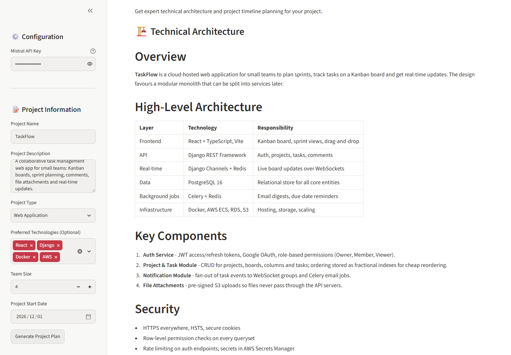
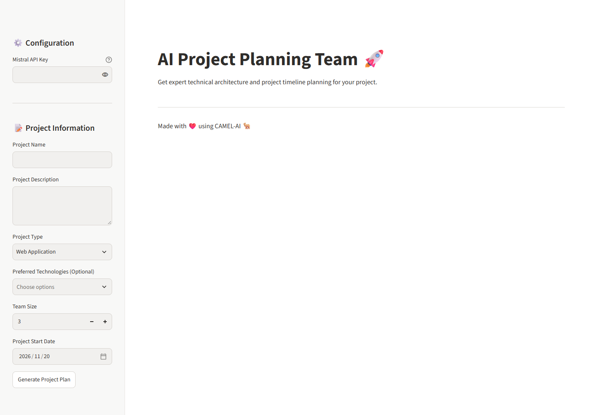
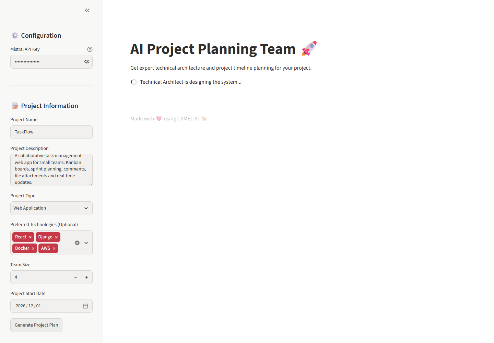
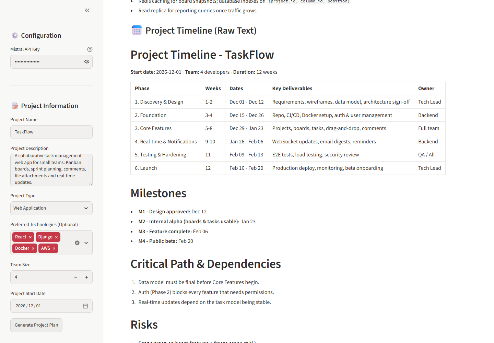
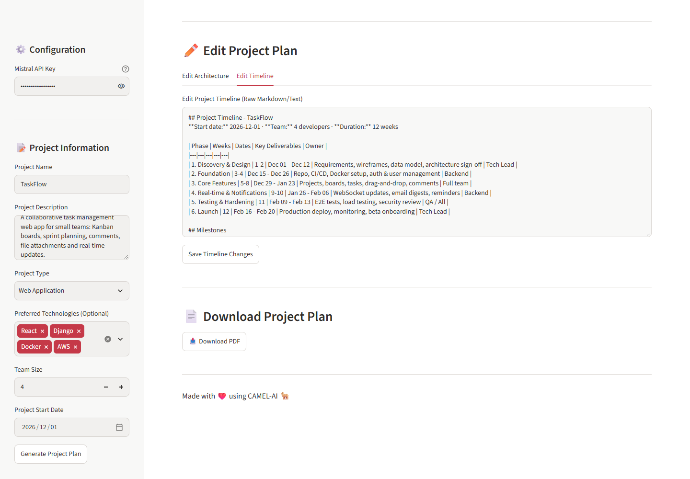
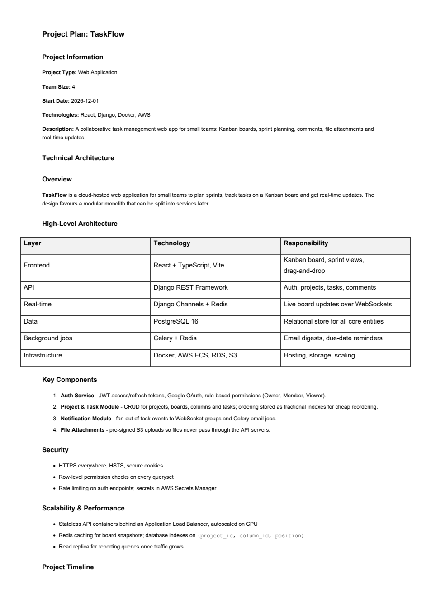

# AI Project Planning Team 🚀

An intelligent project planning tool powered by Mistral AI and CAMEL-AI that helps teams create detailed technical architecture and project timelines. This Streamlit application leverages CAMEL-AI framework to provide expert-level project planning assistance.

You describe your project in the sidebar, and two AI agents work on it in turn: a **Technical Architect** designs the system, then a **Project Timeline Planner** breaks the work into phases and milestones. You can edit both results and download everything as a PDF.



## 🌟 Features

- **Technical Architecture Design**: Get AI-powered recommendations for system architecture, technologies, and frameworks
- **Project Timeline Planning**: Generate detailed project timelines with phases, milestones, and deadlines
- **Interactive Editing**: Modify and customize both architecture and timeline plans
- **PDF Export**: Download your project plan as a professionally formatted PDF
- **User-Friendly Interface**: Clean and intuitive Streamlit-based UI

## 🖼️ How It Works

> The example below plans a sample project called **TaskFlow** (a team task-management web app). The screenshots are from the real app UI; the plan text shown is sample output written for this walkthrough, so your results from Mistral will differ in wording and detail.

### 1. Open the app

The sidebar holds your Mistral API key and the project details. The main area stays empty until a plan is generated.



### 2. Describe your project and click **Generate Project Plan**

Fill in the project name, description, type, preferred technologies, team size and start date. The agents run one after the other, and a spinner shows which one is working.



### 3. Review the technical architecture

The Technical Architect agent proposes the architecture: layers and technologies, key components, security and scalability.


### 4. Review the project timeline

The Project Timeline Planner agent turns the same project details into phases with dates, milestones, the critical path and risks, sized to your team and start date.



### 5. Edit the plan and download it

Use the **Edit Architecture** / **Edit Timeline** tabs to change the generated Markdown, click **Save**, then **Download PDF**.



### 6. Share the PDF

The exported PDF contains the project information, the architecture and the timeline, including tables.



## 🛠️ Prerequisites

- Python 3.11+ (tested with Python 3.12)
- Mistral AI API key (Get it from [Mistral AI Console](https://console.mistral.ai/home))

## 📦 Installation

1. Clone the repository:
```bash
git clone https://github.com/Harsh1tSh/AI-Project-Planner
cd AI-Project-Planner
```

2. Create and activate a virtual environment:
```bash
python -m venv venv

# Windows
venv\Scripts\activate
# macOS / Linux
source venv/bin/activate
```

3. Install the required dependencies:
```bash
pip install -r requirements.txt
```

4. Access the Directory
```bash
cd Project_manager
```

## 🔧 Required Dependencies

- streamlit
- xhtml2pdf
- jinja2
- markdown
- camel-ai
- mistralai (the Mistral SDK that camel-ai uses to call the model)
- mcp < 2 (current camel-ai releases fail to import with `mcp` 2.x)

## 🚀 Usage

1. Start the application:
```bash
streamlit run Project_planner.py
```

2. Open your web browser and navigate to the provided local URL (typically http://localhost:8501)

3. Enter your Mistral AI API key in the sidebar and press Enter

4. Fill in the project details:
   - Project Name
   - Project Description
   - Project Type
   - Preferred Technologies
   - Team Size
   - Start Date

5. Click "Generate Project Plan" to create your project plan

6. Review, edit, and download your project plan as needed

## 📋 Project Information Input

The application accepts the following project details:

- **Project Types**: Web Application, Mobile App, Desktop Application, API Service, Data Pipeline, Other
- **Technologies**: Python, JavaScript, Java, C#, Go, Ruby, PHP, React, Angular, Vue.js, Node.js, Django, Flask, Spring, .NET, Docker, Kubernetes, AWS, Azure, GCP
- **Team Size**: 1-20 members
- **Start Date**: Custom date selection

## 📄 Output

The application generates:
1. Technical Architecture document
2. Detailed Project Timeline
3. Exportable PDF containing all project information


## 🙏 Acknowledgments

- Built with [CAMEL-AI](https://github.com/camel-ai/camel)
- Powered by [Mistral AI](https://mistral.ai/)
- UI Framework: [Streamlit](https://streamlit.io/)

## 📧 Support

For support, please open an issue in the repository or contact the maintainers.
